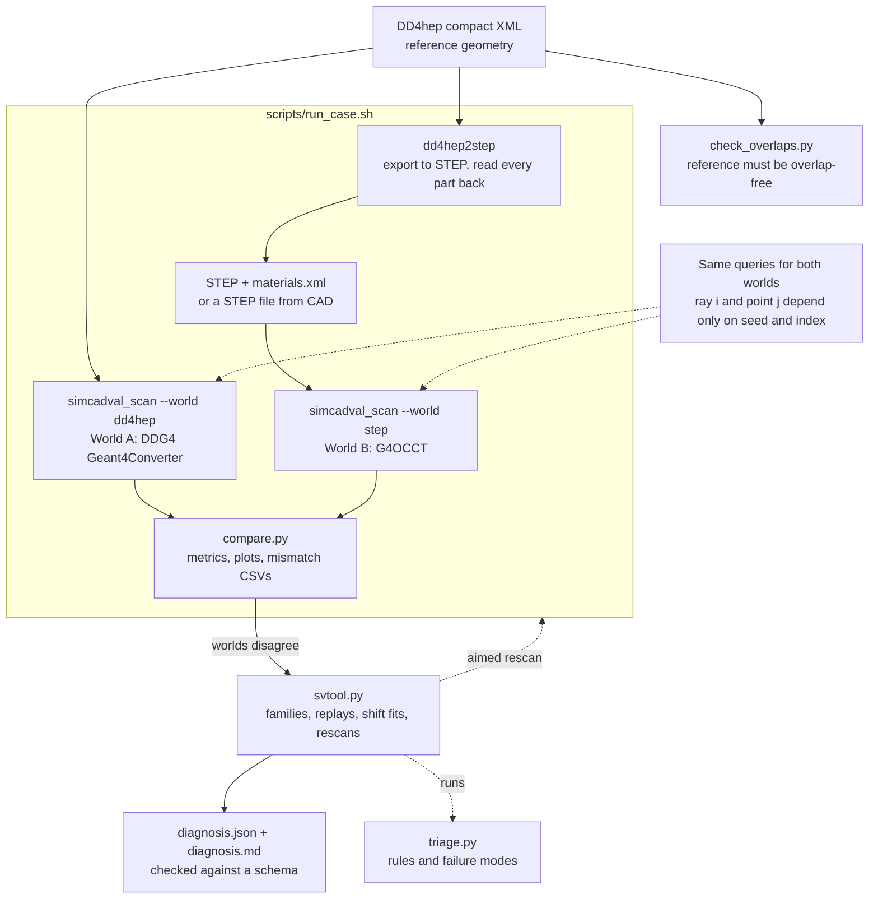

# simcadval

Check that a CAD (STEP) model of a detector is the same geometry as the
DD4hep simulation geometry, as far as Geant4 can tell. The two are compared
by **the questions Geant4 asks of a geometry**, not by converting one into
the other:

1. *"Where is the next boundary along this ray?"* (geantino tracking)
2. *"What material am I in?"* (`G4Navigator::LocateGlobalPointAndSetup`)

The detector is loaded as a Geant4 world twice: once from the DD4hep compact
file through DDG4 (what `ddsim` runs), and once from the STEP file through
[G4OCCT](https://github.com/eic/G4OCCT). The same rays and points go through
both. If the answers agree on a dense sample, the simulation cannot tell the
two worlds apart. If they disagree, triage says where and under which
conditions.

## How it works



## Quick start

Everything needed (DD4hep, Geant4, ROOT, OpenCASCADE, G4OCCT, Python 3 with
numpy, scipy and matplotlib) ships in the EIC `eic_xl` container. `eic.sh`
runs a command inside it and needs singularity/apptainer and `/cvmfs`. The
image is pinned to `eic_xl:26.11.0-stable`; override it with `EIC_IMG=...`.
All commands run from the repo root.

**1. Build** (against the G4OCCT in the container; for another G4OCCT add
`-DCMAKE_PREFIX_PATH=<its install prefix>`):

```bash
./eic.sh 'cmake -S . -B build && cmake --build build -j'
```

**2. Smoke test.** Seven thin touching slabs, rotated like an ECal layer. It
runs in seconds:

```bash
./eic.sh 'scripts/run_case.sh slabs examples/Slabs.xml --rays 20000 --ray-mode aim \
          --box 1000,1000,1000 --target 1241.8,384.1,0,2,40,150 --points 0'
```

Expect agreement at floating-point level: `material agreement 0.999999999`,
`boundary F1 @1nm 1.000000`, `max shift 5.19e-09 mm`.

**3. Example detector.** MiniSiD is a trimmed DD4hep SiD: beampipe, Si vertex
barrel and 12-stave ECal barrel, with 242 volumes and 139 STEP parts. A full
run takes about 2 minutes:

```bash
./eic.sh 'scripts/run_case.sh minisid examples/MiniSiD.xml \
          --rays 20000 --ray-mode ip --points 1000000 --box 1450,1450,1800'
```

With the container's G4OCCT (v0.2.1) the worlds do **not** fully agree:
`material agreement 0.989515801` (about 1 % of the ray length inside the
detector), all of it in thin ECal slices that World B reads as Air.
Meanwhile 1 000 000 of 1 000 000 points agree. Random points almost never land
on a surface, but a track is on one every time it enters a volume. When the
track enters a thin slab from a touching neighbour, G4OCCT can classify the
entry point as outside the slab, and the track then crosses the slab as Air
(reported in [eic/G4OCCT#405](https://github.com/eic/G4OCCT/issues/405)). The
step boundaries are all in the right places; only the material of those
steps is wrong. This is why rays are needed as well as points, and it makes
MiniSiD a good case for step 4.

**4. Triage** (about 1 minute):

```bash
./eic.sh 'python3 scripts/triage.py out/minisid'
```

Read `out/minisid/cmp/triage/triage.md`. For MiniSiD it finds one rule that
covers 99.1 % of the mismatching steps on held-out rays: a slab with
half-thickness ≤ 0.155 mm whose placement is rotated more than 29° off the
90° grid, at ECal radius. It also finds
two failure modes (Kapton → Air and Copper → Air), each with ready commands
to replay a representative ray.

**5. Diagnosis.** `scripts/svtool.py` holds the investigation tools: each
takes named arguments and prints one JSON object, so a person, Claude Code or
any other agent can use them (Reference, Investigation tools). For example,
every mismatch family of the case, and what its boundaries say about the cause:

```bash
scripts/svtool.py mismatch_families --case out/minisid
```

The repo also ships a Claude Code skill, `investigate-mismatch`. Ask
[Claude Code](https://claude.com/claude-code) in this directory to "investigate
the mismatch in out/minisid". It follows
`.claude/skills/investigate-mismatch/SKILL.md`: reads the metrics and the
triage report, replays rays, runs targeted rescans if needed, and writes
`out/minisid/cmp/diagnosis.md`. That file sorts each finding into placement,
material, missing part, navigation artifact or no difference, with the
commands and output lines as evidence.

## Reading the results

`run_case.sh` prints `out/NAME/summary.txt`. Its first lines, for the MiniSiD
run above:

```
== dd4hep vs step: 20000 rays (ip), 1000000 points
  material agreement (non-world ray length): 0.989515801   mismatch 3.381e+04 mm of 3.225e+06 mm
  point material agreement: 1.000000  CI95 0.999996-1.000000  (0 disagree)
  boundary F1 @1nm 0.871695  @1um 0.871695   max shift 0.575 mm   (n_a=3291071, n_b=3216345)
  ...
  worst volumes (mismatch length):
    slice3@18    IoU 0.686502  mismatch 1793 mm
```

* **Material agreement** is the headline: the share of ray length inside the
  detector where both worlds report the same material. Two identical
  geometries give about 1 − 1e-9 (floating point); anything clearly larger is
  a real difference.
* **Point agreement** checks the material at random points. It catches wrong
  materials and misplaced volumes, but not errors that only occur when a
  track crosses a surface, which is why rays are needed too (MiniSiD above).
* **Boundary F1 and max shift** tell a moved boundary from a missing one. A
  small max shift with F1 near 1 means a displacement of that size. F1 well
  below 1 means material boundaries are missing, for example a slab read as
  the material next to it, and the max shift is then the gap to the next
  boundary, not a displacement.
* **Worst volumes** name the parts where the mismatch is, as `<volume>@<id>`.

All metrics are defined under [Metrics](#metrics-comparepy). Machine-readable
results are in `out/NAME/cmp/metrics.json`, with plots and
`ray_mismatches.csv` / `point_mismatches.csv` next to it. For a table across
cases, run `python3 scripts/summarize.py out/*/cmp`.

## Your own geometry

Check the reference for overlaps first. Where DD4hep volumes overlap, the
reference answer itself is ambiguous:

```bash
./eic.sh 'python3 scripts/check_overlaps.py my_detector.xml'    # optional 2nd arg: tolerance in cm (default 1e-4)
```

Then run `run_case.sh NAME COMPACT [scan options]`. It exports the STEP file,
scans both worlds and compares them, writing to `out/NAME/`.

| Scan option | Meaning |
|---|---|
| `--rays N` | number of geantino rays |
| `--ray-mode ip` | rays isotropic from the origin |
| `--ray-mode box` | ray origins uniform in `--box`, isotropic directions |
| `--ray-mode aim` | origins in `--box`, aimed at a uniform point of `--target cx,cy,cz,hx,hy,hz` |
| `--points M` | points uniform in `--box hx,hy,hz` (half-lengths, mm) |
| `--seed S` | changes the sample; the same seed gives the same rays and points in both worlds |

Environment variables for `run_case.sh`:

| Variable | Effect |
|---|---|
| `STEP=<file>` | use this STEP file instead of exporting one |
| `MATMAP=<file>` | material map for World B (default `<STEP>.materials.xml`) |
| `EXPORT_ARGS=...` | extra `dd4hep2step` options, e.g. `--perturb <volume>:dx,dy,dz` to move a volume |
| `BUILD=<dir>`, `OUT=<dir>`, `SCANNER=<exe>` | build directory, output root, scanner binary |

**STEP from CAD.** A STEP file that was not made by `dd4hep2step` needs a
G4OCCT material map from its part names to DD4hep material names:

```xml
<materials>
  <material stepName="slice3@18" geant4Name="Kapton"/>
</materials>
```

Material metrics work with any part names. Volume-level metrics (volume-id
agreement, worst volumes) need part names in the form `<volume>@<id>`, where
`<id>` is the DD4hep volume number used by `dd4hep2step` (see
`export.json`); parts without it count as unmapped.

## Checks

**Metric self-test.** This checks that deliberately wrong CAD is detected and
localised. It takes about 3 minutes:

```bash
./eic.sh 'scripts/selftest.sh'        # optional: scan args (default 20000 ip rays, 10^6 points)
```

It exports MiniSiD once correctly and once with each injected fault, then
compares each faulty STEP world with the correct STEP world. Both are
navigated by the same G4OCCT, so G4OCCT's own disagreements with DD4hep are
the same in both and cancel; only the injected fault remains. It prints PASS
or FAIL per check, and the exit status is 0 only if all pass.

| Fault | Checks | Result (seed 12345) |
|---|---|---|
| inner vertex modules shifted 10 µm in z (`--perturb`) | mismatch only in the two moved parts; max boundary shift within ×0.5–2 of the shift | only `component0@4`, `component1@5`; max shift 0.01037 mm |
| same, 1 µm | same checks, and the mismatch scales ×5–20 between 10 µm and 1 µm | max shift 0.001037 mm; ratio 10.00 |
| one Kapton slice prototype read as Copper (edited `materials.xml`) | volume mismatch exactly 0 (geometry untouched); only Kapton and Copper lose IoU; every disagreeing point is Kapton → Copper | 310 points, all Kapton → Copper |
| none: the DD4hep world scanned in two processes | identical answers | 0 mm mismatch |

## Reference

### Export (`dd4hep2step`)

* A volume becomes a STEP part if its material differs from the world
  material. World-material regions stay empty and resolve to the world on
  import.
* Each part is its own shape **minus all daughters** (assemblies looked
  through), so parts never overlap and a flat import is a valid placement.
* One prototype per `TGeoVolume`, placed by XCAF references (STEP instancing
  → shared logical volumes).
* Part names are `<volume>@<id>`. The XDE material attribute is the DD4hep
  material name. A G4OCCT `materials.xml` is written as well, because XDE
  materials do not survive the OCCT 8.0 write→read round trip.
* Shapes: Box, Tube/TubeSeg/Cone/ConeSeg/Pcon, Pgon, Trd1/Trd2/Arb8/Trap/Gtra/Para,
  Xtru, Sphere, Torus, Eltu, Boolean composites, Scaled.
* Every part is read back from the written STEP file. Each one must come back
  as a single solid whose volume matches `TGeoShape::Capacity()`. If any does
  not, the exporter exits with code 4.

### Metrics (`compare.py`)

Ray metrics overlay the two piecewise-constant material functions along each
ray exactly (the union of both sets of step boundaries), so no along-ray
sampling step enters. "Non-world length" is the ray length where at least one
world is not in the world material. It is the denominator for the fractions,
so air outside the detector does not dilute them.

| Metric | Definition |
|---|---|
| material agreement | 1 − (length with mat_A ≠ mat_B) / non-world length |
| per-material IoU | L(A=m ∧ B=m) / L(A=m ∨ B=m) |
| confusion matrix | ray length with (mat_A, mat_B) |
| X/X₀, λ/λ_I per ray | Σ len/X₀ in each world, and their relative difference |
| boundary P/R/F1 @ τ | material-change boundaries matched to the nearest same-transition boundary on the same ray within τ (1 nm … 1 mm) |
| max boundary shift | largest nearest-boundary distance along rays. It is a real shift only when the transitions match; for a missing boundary it is the gap to the next one |
| sequence identity | fraction of rays with an identical collapsed material sequence |
| volume-id agreement | material agreement computed on DD4hep volume ids instead of materials |
| point agreement | fraction of points with equal material (Wilson 95 % CI), and its confusion matrix |
| cost | CPU µs per ray and per point in each world |

### Mismatch triage (`triage.py`)

`compare.py` says how much the worlds disagree and where. `triage.py` says
what the disagreeing places have in common, so that a disagreement can be
traced to specific parts and conditions. It only post-processes the stored
scans and needs nothing beyond CPU (numpy, scipy, ROOT/DD4hep).

1. **Label.** Each step of the DD4hep world (ray, step index, placed volume)
   is *positive* if the exact overlay shows more than `--min-mm` (1 nm) of
   material mismatch inside it.
2. **Sample.** Positive steps are stratified by (reference material →
   candidate material, solid class), with small strata kept whole, so a rare
   failure is not drowned out by a common one. Negative steps are sampled at
   20 per positive. Weights restore the population, and every reported rate
   is population-weighted.
3. **Describe.** The compact file is reloaded as TGeo and about 35 generic
   features are computed for each sampled step. *What* features describe the
   mechanism: material, solid class, entry face and its owner, incidence
   angle, face size, solid size, placement rotation, safety, step length.
   *Where* features describe the location: r, z, φ, η, step index, volume
   name.
4. **Analyse.**
   * Weighted ROC AUC of each single feature.
   * A depth-4 decision tree trained on even rays and scored on odd rays.
     Each leaf that predicts mismatch is a readable rule with held-out
     precision and recall. Rules whose precision is under 80 % get a
     drill-down tree.
   * Ward clustering of the positive steps into failure modes. k is chosen by
     silhouette score, with k = 1 when there is no structure. Each mode comes
     with a representative ray and ready `show_ray.py` and
     `simcadval_scan --debug-ray` commands to replay it.

Outputs in `CASE/cmp/triage/`: `triage.md` (the report), `triage.json`,
`features.csv.gz` (one row per sampled step), `feature_auc.png` and
`clusters.png`. The rules and modes are correlations in the reference frame;
confirm them with a replay. Options: `--min-mm`, `--neg-ratio`, `--max-pos`,
`--depth`, `--max-k`, `--min-pos` (below this many positive steps, all of them
are listed instead of analysed), `--seed`, `--out`, `--no-plots`.

### Investigation tools (`svtool.py`)

`scripts/svtool.py TOOL --arg value ...` or `scripts/svtool.py call TOOL
'{"arg": ...}'`. Outside the container it re-runs itself through `eic.sh`.
`scripts/svtool.py spec [--format openai]` prints the tool definitions
(name, description, JSON Schema of the arguments) for an agent. Each call on a
case is logged with an id to `CASE/investigation/calls.jsonl`, and library
output goes to `CASE/investigation/svtool.log`, so stdout is only JSON.

| Tool | What it returns |
|---|---|
| `case_summary` | headline metrics, worst parts, robustness counters, export status, a no-difference test |
| `mismatch_families` | mismatching ray length grouped by (material A → B, volume A, volume B): share, parts, region, example intervals, and the boundary pattern (below) |
| `point_mismatches` | points with different materials, grouped the same way |
| `ray` | one ray as the exact overlay of both worlds, marking which world has a boundary at each row |
| `debug_ray` | `simcadval_scan --debug-ray` parsed: what each nearby STEP part answers at each step point |
| `material_map` | the STEP world's material map against the DD4hep material of every part |
| `part_info` | export record of a part and its placements (global bounding box, translation, rotation) |
| `boundary_shifts` | boundaries matched across worlds (exact, shifted, lost), face normals from TGeo, and fits of the displacement D (translation, or translation + small rotation, overall or per placement) |
| `rescan` | `run_case.sh` with rays aimed at a box, reusing the case's STEP and map, into `CASE/investigation/NAME` (itself a case) |
| `triage` | `triage.py` output, condensed |
| `submit_diagnosis` | checks a diagnosis (schema, cited call ids, part names, shares) and writes `cmp/diagnosis.json` and `diagnosis.md` |

The boundary pattern of a family compares the interval ends with the step
boundaries of each world. `same_boundaries`: only the material differs, either
a wrong material or navigation that walks the part as the world. `only_in_a`:
B lacks the part's faces, so the part is missing. `only_in_b`: an extra part in
B. `one_end_each`: a boundary moved, i.e. a placement or size difference. For moved
boundaries, `boundary_shifts` uses that a face with normal n moved by D shifts
the boundary along a ray with direction u by Δs = (D·n)/(u·n). Each ray
through the face therefore gives one equation D·n = Δs (u·n), and the least-squares
fit reports D along the face normals that were sampled.

A diagnosis (`schemas/diagnosis.schema.json`, `simcadval-diagnosis/1`) has a
one-sentence verdict and one finding per cause: category, parts
(`name@id` or `name@*`), materials A → B, share of the mismatch length,
magnitude (summary, and optionally displacement, rotation, boundary shift or
B's material), confidence, explanation, and evidence as
`{call id, what its output shows}`.

### Layout

| Path | What |
|---|---|
| `src/dd4hep2step.cc`, `tgeo_reader.cc`, `occt_writer.cc`, `geo_desc.hh` | DD4hep → STEP exporter. ROOT and OCCT live in separate translation units (`geo_desc.hh` is the std-only interface between them) |
| `src/simcadval_scan.cc`, `step_world.cc` | Geant4 app: one world per run, geantino scan, point sampling, `--debug-ray` replay |
| `src/geo_ids.hh` | volume numbering shared by the exporter and the scanner |
| `scripts/run_case.sh` | export → scan ×2 → compare, for one case |
| `scripts/compare.py` | metrics and plots for one case |
| `scripts/triage.py` | mismatch triage for one case: features, rules, failure modes |
| `scripts/show_ray.py` | side-by-side step listing of one ray in both worlds |
| `scripts/selftest.sh` | metric self-test with injected faults |
| `scripts/check_overlaps.py` | TGeo overlap check of a compact file |
| `scripts/summarize.py` | markdown table of headline metrics across cases |
| `examples/MiniSiD.xml` | trimmed DD4hep SiD: beampipe, Si vertex barrel, 12-stave ECal barrel |
| `examples/Slabs.xml` | seven thin touching rotated slabs (smoke test) |
| `eic.sh` | runs a command in the `eic_xl` container |
| `scripts/svtool.py` | investigation tools (JSON in, JSON out) and the diagnosis checker/renderer |
| `schemas/diagnosis.schema.json` | the diagnosis format |
| `.claude/skills/investigate-mismatch/` | Claude Code skill: diagnose a case's mismatch and write `diagnosis.md` |

## License

simcadval is licensed under the GNU Lesser General Public License, version 3
or (at your option) any later version (`LGPL-3.0-or-later`). `COPYING.LESSER`
holds the LGPL text, and `COPYING` holds the GNU GPL v3 text that the LGPL
builds on.

`examples/MiniSiD.xml` and `examples/SiDConstants.xml` are modified copies of
DD4hep's SiD compact files (Copyright (C) CERN). DD4hep is licensed under
LGPL-3.0 with no "or later" option, so these two files are `LGPL-3.0-only`.
The header of each file says what was changed. The dependencies (Geant4, DD4hep, ROOT, OCCT,
G4OCCT) keep their own licenses.
